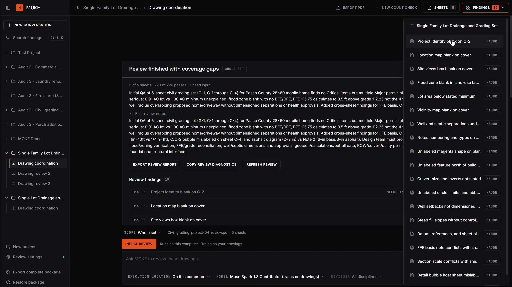
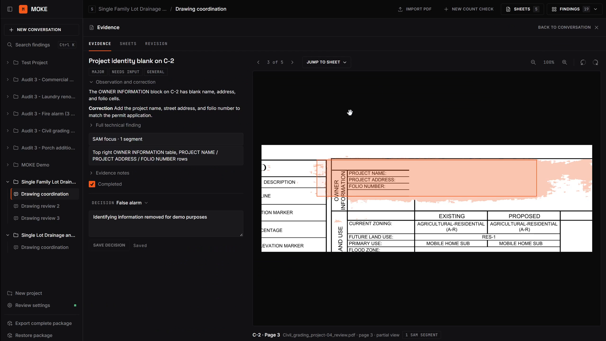
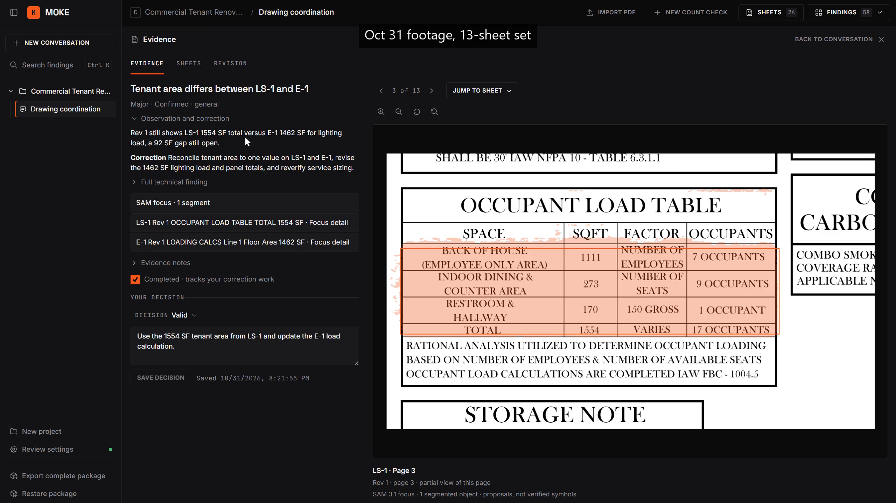

# Moke

Moke is a desktop workbench for reviewing engineering drawing packets, built for
the Meta AI Developer Hackathon. Import the drawings and ask for a whole-set QA
pass or a discipline review. Moke reads source images, follows its review
instructions, records findings and coverage, and produces an offline HTML report.
Follow-up requests can deepen the review while retaining earlier issue IDs.

[Watch the narrated demo on YouTube](https://youtu.be/wl8wwq_Tlrw).



## The review workflow

1. **Import the packet.** Create a project and import its PDFs. Start a review
   without creating a count check or manually confirming every sheet first.
2. **Ask for the review.** For example, ask "Please run a quick QA pass on this
   drawing set" or "Review the electrical design and supporting calculations."
   Choose a model and reviewer, or let Auto route the request. A saved note does
   not start inference.
3. **Follow the inspection.** Moke inventories the supplied sheets, opens source
   images and detail crops, and records the four review passes: document
   completeness, code and agency requirements, coordination, and prior comments.
   A Florida code index points each check to its code section, statute or rule.
   Public-source lookup with PDF text and repeatable arithmetic support the
   inspection. With a Meta key, SAM 3.1 segments drawn devices and fixtures for
   counts and zooms into each finding's problem area.
4. **Review the findings and gaps.** Each issue identifies its location, evidence,
   correction and supporting sources or calculations. Unreviewed sheets,
   inaccessible governing text and missing project inputs remain visible. Mark
   a finding valid, a false alarm, not applicable or a duplicate, with a reason;
   follow-up questions in the same conversation read that decision. A firm
   checklist in Review settings applies the firm's own checks to new reviews.
5. **Export the report.** The self-contained HTML includes findings, embedded
   evidence, coverage, citation status, calculations and prior-comment tracking.
   Its Completed checkboxes track the user's corrections separately from finding
   status and reviewer-verified closure. Export a complete package to preserve
   the source files and execution history as well.



Revision reviews carry earlier findings into the revised sheets. The demo also
shows a finding that remained open on a 13-sheet set reviewed on October 31.



Drawn-to-schedule count comparisons remain available as specialized checks.
Reviewers accept their count inputs and coverage before deterministic comparison;
corrections and revision rechecks retain their history. The
[two-sheet count demonstration](docs/fixtures/hero-case.md) exercises a supported
issue, corrected false alarm, unchanged control and revision recheck.

A review report states what was actually inspected. Model findings are review
results, and a finished execution does not provide professional approval.
Regulatory findings need applicable governing sources; unavailable sources and
unknown editions remain Needs input. SAM geometry does not establish physical
dimensions.

## Install

Download the installer for Windows, macOS (Apple silicon) or Linux from
[GitHub Releases](https://github.com/sc-frederick/moke-meta-hackathon/releases/latest).
The installers are unsigned. macOS can block the first launch; allow it under
System Settings › Privacy & Security › Open Anyway. On Linux, make the AppImage
executable or install the `.deb`. Model reviews need a provider key; see
[inference setup](docs/inference.md).

## How it works

| Process            | Owns                                                                                           |
| ------------------ | ---------------------------------------------------------------------------------------------- |
| SvelteKit renderer | Projects, conversations, findings, and source inspection                                       |
| Electron           | Windows, menus, file dialogs, protected credentials, and the trusted renderer bridge           |
| Bun backend        | Effect application services, SQLite, PDF workers, evidence, calculations, and review execution |

Effect Schema contracts validate process messages. The renderer uses Effect RPC
over authorized Electron MessagePorts; Electron forwards application requests to
Bun over authenticated loopback HTTP. Database access and provider credentials
stay outside the renderer.

Pi Durable journals the review and runs the full Moke system instructions. A
separate ledger records model and SAM intent before dispatch, preserving unknown
outcomes without automatic resends. Reviews have pause and cancel controls and an
optional call budget. The default packet review has no application call ceiling;
long conversations use Pi compaction. Complete packages export and restore the
database, original PDFs, rendered evidence and execution journals together.

Projects run locally, but inference uses hosted Meta, Baseten or OpenCode Go APIs,
or a custom endpoint you add, and sends selected drawing evidence to that provider. **Push to cloud** transfers the complete
workspace for a new bounded review, streams progress, and automatically syncs results with local
ownership checks. See [cloud setup and limits](docs/cloud-reviews.md),
[the runtime decision](docs/review-runtime.md), and
[data and recovery](docs/data.md).

## Development

Install the Bun version pinned in [.bun-version](.bun-version), then run:

```sh
bun install --frozen-lockfile
bun run dev
```

You can import drawings and use manual count checks without provider keys.
For model review, copy [.env.example](.env.example) to `.env` and set
`OPENCODE_API_KEY`, `MODEL_API_KEY` or `BASETEN_API_KEY`. With a Go key, reviews run
on Muse Spark 1.3 Contributor through OpenCode Go, and Meta's API is used only for
SAM and count checks. Contributor trains on your drawings, and Go refuses it until
a workspace owner allows that. Otherwise choose
Muse Spark, Muse Wonder or Baseten Muse Spark Open in the app.
Restart after changing credentials. See [inference setup](docs/inference.md) for
packaged-app credentials, model capabilities and optional review budgets.

Bun runs tools and the application backend. The packaged app includes the Bun
executable, PDF renderer, and native assets; users do not install Bun or Node.
Build installers with `bun run package:desktop`. See [desktop builds and releases](docs/deployment.md).

## Verification

```sh
bun run verify          # checks, smoke tests, builds, and Electron end-to-end tests
bun run test:packaged   # after packaging, repeat the desktop flow against the packaged executable
bun run test:screenshots # offline fixture captures in test-results/
```

Tests use real local databases, RPC, PDF workers, and Electron. Hosted-provider
boundaries use local transports; normal verification requires no keys and makes
no paid requests. Headless Linux needs an X display, for example
`xvfb-run -a bun run verify`. Install Poppler for the optional experiment smoke
tests; they skip explicitly when `pdftoppm` is unavailable.

The README screenshots are frames from the narrated demo, showing actual review
results and saved decisions. The [screenshot source notes](docs/screenshots/README.md)
record the video and frame timestamps. [Development and testing](docs/development.md)
explains the suite layout, offline fixture captures, and toolchain.

## Repository layout

```text
src/          SvelteKit workbench and shared Effect Schema/RPC contracts
desktop/     Electron shell, preload, and backend connection
backend/      Application services, PDF workers, inference, and review storage
migrations/   Immutable SQLite migrations
tests/       Smoke tests, Electron end-to-end flows, and synthetic fixtures
scripts/      Development, build, packaged checks, and opt-in model experiments
docs/        Setup, architecture, screenshots, and validation evidence
experiments/  SAM recipes, captured proposals, and research evidence
```

The [documentation index](docs/README.md) separates setup and architecture from
validation records and drawing experiments. The [workbench design notes](docs/design.md)
record the Forge design system, its adaptations, and third-party asset attribution.

## Hackathon provenance

This entry addresses **Build for Your World**. The application work in this
repository began on October 27, 2026. The [rules and evidence review](docs/validation/hackathon-readiness.md)
maps the public repository, Meta model integration, demo, and source attribution
to the participant guide checked on November 4.

The Moke name, review prompts, and the owner's 2023 Florida Building Code
plan-review reference predate this entry. The code index tooling and
`florida-code-additions.md` were added during the hackathon; see the
[code index provenance](backend/review/code-index/README.md).
This repository implements a fresh application from the project-kit desktop starter, with drawing evidence,
corrections, and revision tracking built for the hackathon. It does not reuse the
earlier Moke application. Pi Durable provides agent execution as an MIT-licensed
dependency; the new work is the drawing-review application, evidence handling,
corrections, revision behavior and portable review execution. Prompt and
dependency provenance live in
[the project manifest](.project-kit/manifest.json) and
[the review prompt sources](backend/review/prompts/README.md).

## License

Moke is released under the [MIT License](LICENSE). Vendored code and third-party
assets keep their own licenses. The styles in `src/lib/forge.css` are adapted from
Uiverse Design's Forge and remain under its license; see
[the design notes](docs/design.md).
